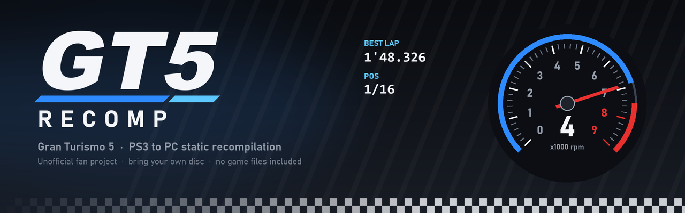
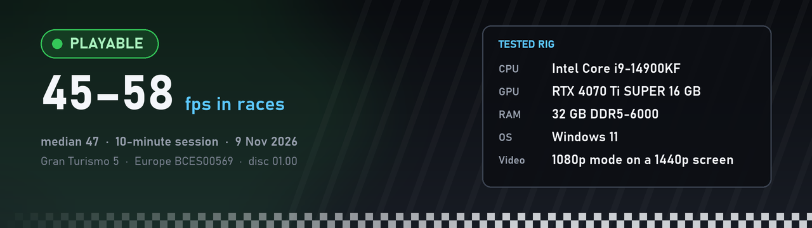

<p align="center">
  
</p>

<p align="center">
  <a href="https://github.com/MormonFTP-hub/gt5-recomp/releases"></a>
  
  
  
  
  
</p>

# GT5 Recomp

An unofficial PC port of **Gran Turismo 5** (PS3) made by static recompilation: the game's
PowerPC and SPU code is translated into C++ that is compiled for Windows x64, and the PS3's graphics,
sound, input and system calls are reimplemented on Windows (Direct3D 12 for the RSX).

It is built on [ps3recomp](https://github.com/sp00nznet/ps3recomp) and borrows from the
[GT5 Prologue port](https://github.com/sp00nznet/GT5P), both by Ned Heller (sp00nznet).

> **Game version required:** your own **Gran Turismo 5** Blu-ray disc, using the disc's own
> executable (version **01.00**, with **no game update** installed):
>
> - **Europe, BCES00569**: tested. This is the copy the port was built from.
> - **North America, BCUS98114**: expected to work, not tested yet. The lift finds the few addresses
>   that differ between releases in your own executable.
>
> See [Which copy of GT5](#which-copy-of-gt5) for how to check your files.

## 📋 Current state

<p align="center">
  
</p>

**Playable.** Races run at 45 to 58 fps on the tested rig, and most of the game's modes work. The full
board (tested rig, what works, what's being worked on, known issues, recent changes) is in
[STATUS.md](STATUS.md); updates are also posted in
[Announcements](https://github.com/MormonFTP-hub/gt5-recomp/discussions/categories/announcements).
Everything done on the port since the first day, with dates, is in [CHANGELOG.md](CHANGELOG.md).

## 🏁 Try it, then tell me how it went

If you own the game, please set it up and play. Every result helps decide what gets fixed next,
whether it runs great, half works, or doesn't build at all. US players especially: the US release
hasn't been tested yet.

| You want to... | Go here |
|---|---|
| Say how it went (takes two minutes, mostly quick picks) | [Tried it: here's how it went](https://github.com/MormonFTP-hub/gt5-recomp/issues/new?template=1-tried-it.yml) |
| Report something broken | [Something's broken](https://github.com/MormonFTP-hub/gt5-recomp/issues/new?template=2-problem.yml) |
| Ask for a change | [Suggest a change](https://github.com/MormonFTP-hub/gt5-recomp/issues/new?template=3-idea.yml) |
| Post quick results, screenshots of it running, or ask for help | [Discussions](https://github.com/MormonFTP-hub/gt5-recomp/discussions/1) |
| Talk to me directly | Discord: **mormonftp** (add me and send a message) |

## 🔧 Fork it, mod it

Forks are welcome; take whatever you like (MIT license). If you make something good, open a pull
request or [show it here](https://github.com/MormonFTP-hub/gt5-recomp/issues/new?template=4-my-fork-or-mod.yml)
so it can come back into the main repo. [MODDING.md](MODDING.md) covers the ways in: switchable
game-code mods in `GT5\mods`, the graphics, controller and sound code, and the tools for finding
your way around. [CONTRIBUTING.md](CONTRIBUTING.md) has the few rules.

## ❓ FAQ

| Question | Short answer |
|---|---|
| Steering wheels? | 🔧 Being built now, coming in the next version |
| Force feedback? | 🔧 Being built with wheel support |
| Widescreen (16:9)? | ✅ Yes, GT5 is a 16:9 game |
| Ultrawide (21:9, 32:9)? | ❌ Not yet: black bars at the sides |
| Which controllers? | ✅ DualSense, DualShock 4, Xbox pads, keyboard |
| US copy (BCUS98114)? | ⚠️ Should work, not tested yet |
| Online? | ❌ No |
| Is it legal? | ✅ No game files here: you build it from your own disc |
| Ready-made download? | ❌ No, and there never can be (see below) |
| Errors during setup? | 🛠️ Run `setup.ps1` (see below) |

**Q: Does it support steering wheels and force feedback?**

**A: Not yet, but they're being built now and should arrive in the next version.** On a PS3, GT5 talks
to its Logitech wheels (Driving Force GT, G25, G27) directly over USB, for both steering and force
feedback. The port is learning to present your PC wheel to the game as one of those Logitech wheels,
and to turn the game's force-feedback commands into effects on your wheel. It's being written for any
standard PC wheel (Logitech, Thrustmaster, Fanatec and others). Nobody has tested it on a real wheel
yet, so **wheel owners are wanted**: when it comes out, please
[tell us how it went](https://github.com/MormonFTP-hub/gt5-recomp/issues/new?template=1-tried-it.yml).
Until then, you could map a wheel to an Xbox controller layout in Steam Input: it should steer and
work the pedals like a pad, without force feedback (untested).

**Q: Does it support widescreen and ultrawide?**

**A: Widescreen yes, ultrawide not yet.** GT5 is a 16:9 game, so a normal widescreen monitor (1920×1080,
2560×1440, 4K) is filled edge to edge. On an ultrawide monitor (21:9 or 32:9) the game still draws 16:9,
and the window adds black bars at the sides. True ultrawide means widening the game's own camera and
moving its HUD, which takes changes to the game's code (a job for a [game-code mod](MODDING.md)). It's
on the list.

**Q: What resolution does it render at?**

**A: Whatever the game picks, as on a PS3, scaled to fit your window.** The window title shows the
current one (races have shown 1280×720). Rendering at a higher resolution is on the list.

**Q: Which controllers work?**

**A: DualSense and DualShock 4 (USB or Bluetooth), Xbox and other XInput pads, and the keyboard.** See
[Controls](#-controls) for the keyboard layout.

**Q: Can I use a US copy?**

**A: Probably.** The tools find the few spots that differ between releases in your own copy (see
[Which copy of GT5](#which-copy-of-gt5)). Nobody has tried a US copy yet, so please report if you do.

**Q: Does online work?**

**A: No.** GT5's online services were shut down, and the port doesn't connect to anything.

**Q: Is there a ready-to-go build I can just download?**

**A: No, and there can't be.** A built `gt5.exe` contains GT5's own code converted for PC, so
sharing one would be sharing the game itself. That's what gets projects like this taken down, and
it's why this one only works from your own disc. Please don't ask for builds or share them. What we
can do is make building easy: `setup.ps1` does nearly all of it, checks every file you add, and tells
you exactly what's missing. If you get stuck, post setup's output in the
[discussions](https://github.com/MormonFTP-hub/gt5-recomp/discussions) and someone will help.

**Q: I get errors like "venv\Scripts\python.exe is not recognized" or "cannot find analysis\version.json". What's wrong?**

**A: Setup hasn't finished, so the tools that later steps use aren't there yet.** `venv` is the Python
environment `setup.ps1` makes. `analysis\version.json` is made by the build itself from your EBOOT.elf,
so it isn't a file you add. Open PowerShell in the `gt5-recomp` folder (the one with `setup.ps1`, not
`GT5\scripts`) and run `powershell -ExecutionPolicy Bypass -File setup.ps1`. It installs what's
missing, lists any of your files that are missing or in the wrong place, and once everything is there
it generates and builds the game for you. If Python itself is missing, install Python 3.11 or newer
from python.org with "Add python.exe to PATH" ticked, then run setup again.

**Q: Is this legal? Do I need the game?**

**A: You need your own copy of GT5, and nothing from the game is in this repository.** It holds only
code written for the port. You build the game yourself from your own disc, and builds must never be
shared (see below).

## ⚖️ What this repository contains, and what it does not

This repository holds only code and scripts written for the port:

- `GT5/patches/ps3recomp.patch`: the changes to ps3recomp (runtime, graphics, SPU, audio, input).
- `GT5/CMakeLists.txt`, `GT5/play.bat`, `GT5/src/`, `GT5/config/`: the GT5 build and launcher.
- `GT5/scripts/`: the lift, build, test and analysis tools.

It does **not** contain, and must never be given:

- any part of the game: the EBOOT, disc or installed files, music, textures, models, shaders,
  menu images, save data, or screenshots;
- code generated from the game (the recompiled `generated/` and `spu/` folders, `src/gen/`): every
  user produces these from their own copy;
- PS3 firmware, system modules, or any decryption key.

You need your own copy of Gran Turismo 5 (BCES00569 or BCUS98114), dumped from a console you own, and PS3 system
software installed from Sony's official update file. Use this only with games you own.

- **Never share what you build.** `gt5.exe`, the `generated/` folder and anything else made by the
  lift contain code recompiled from the game, so each person has to build them from their own copy.
  Don't upload them or a ready-to-play package, and don't ask for them.
- This repository does not include, link to, or explain how to obtain decryption keys or game files.
- Questions about downloaded copies of the game will not be answered.

**Gran Turismo** is a trademark of Sony Interactive Entertainment. This project is not affiliated
with, endorsed by, or connected to Sony Interactive Entertainment or Polyphony Digital.

## 🏎️ Status

- Boots, menus, A-Spec and B-Spec races, licence tests, special events, replays, Photo Mode, the
  Course Maker and GT TV work in testing.
- Performance depends mostly on the CPU: on a fast desktop CPU races run at roughly 45 to 58 fps (see
  [STATUS.md](STATUS.md) for the tested rig). The first visit to a scene stutters while its shaders compile; later visits load them
  from the shader cache.
- Online features do not work. Some graphics issues remain.

## 🧰 Requirements

- Windows 10 or 11 (x64) and a Direct3D 12 graphics card.
- Visual Studio 2022 with *Desktop development with C++* and *C++ Clang tools for Windows*
  (provides clang-cl, CMake and Ninja).
- Python 3.11 or newer, and Git.
- About 25 GB free: the game files are about 17 GB, the build a few more.
- Your own GT5 disc (BCES00569, or BCUS98114 untested) and the means to dump it, and
  [RPCS3](https://rpcs3.net) to install PS3 firmware and decrypt the game's executable.

## Which copy of GT5

Use the Blu-ray disc's own executable, `PS3_GAME\USRDIR\EBOOT.BIN`, application version **01.00**
(the `APP_VER` in `PS3_GAME\PARAM.SFO`). Executables from game updates are not supported.

| Release | Title ID | Status | SHA-1 of the disc's files |
|---|---|---|---|
| Europe / PAL | **BCES00569** | tested | `EBOOT.BIN` `1FFABF4C029CF3099579B73425C91C1FD48CAFCA`, decrypted `EBOOT.elf` `1535B865EC7DD58E7704B378B8621532ECF844E1` |
| North America | **BCUS98114** | expected to work, not tested yet | |

Almost everything in the port works for any release, because the recompiled code is generated from
your own executable. Only three things are tied to where the code sits in one executable: the end of
the code, the game's setjmp/longjmp routines, and one jump table the game builds while it runs.
`GT5\scripts\relift.ps1` starts by running `GT5\scripts\version_addrs.py`, which finds all three in
your EBOOT by what the code looks like, not by address, and prints your EBOOT's SHA-1:

- If every line is found, carry on: your release should work.
- If it prints `NOT FOUND`, that release differs in those places. Please open an issue with that
  output (the text only, never any game file).

Check a file's hash with `Get-FileHash <file> -Algorithm SHA1` in PowerShell.

## 🚦 Setup

**`setup.ps1` does almost everything.** Run it as often as you like. Each time it does what's still
to do, checks your files, and tells you exactly what's missing and how to fix it. Once everything is
in place it builds the game for you. You never need to run the scripts in `GT5\scripts` yourself.

1. Install the tools from [Requirements](#-requirements): Git, Python 3.11 or newer (tick "Add
   python.exe to PATH"), and Visual Studio 2022 with C++ and the Clang tools.
2. Get the port and run setup once. In PowerShell:

   ```
   git clone https://github.com/MormonFTP-hub/gt5-recomp
   cd gt5-recomp
   powershell -ExecutionPolicy Bypass -File setup.ps1
   ```

   It fetches and patches ps3recomp, makes the Python environment and downloads FFmpeg. Then it lists
   the game files you still need to add, marked `[missing]`. Use Git rather than the ZIP download, so
   you can update later.
3. Add your own game files (setup checks each one and catches the usual mistakes):
   - **Game data:** dump your own GT5 disc (BCES00569 or BCUS98114) and copy its `PS3_GAME` folder to
     `GT5\vfs`, so that `GT5\vfs\PS3_GAME\USRDIR` exists.
   - **System software:** in RPCS3, install the PS3 firmware (File > Install Firmware, with
     `PS3UPDAT.PUP` from Sony). Then copy RPCS3's `dev_flash` folder to `GT5\dev_flash`, so that
     `GT5\dev_flash\sys` exists.
   - **The executable:** in RPCS3, Utilities > Decrypt PS3 Binaries, choose your disc's
     `PS3_GAME\USRDIR\EBOOT.BIN`, and save the decrypted file as `GT5\input\EBOOT.elf`. It must be the
     decrypted one: setup tells you if it's still encrypted.
4. Run setup again:

   ```
   powershell -ExecutionPolicy Bypass -File setup.ps1
   ```

   When nothing is missing, it generates the game code from your EBOOT.elf (about 10 minutes) and
   builds `gt5.exe` (20 to 50 minutes the first time, depending on your PC).
5. Play: `GT5\play.bat`. Saves go to `GT5\hdd0`; logs go to `GT5\logs`.

If setup stops with an error, post its whole output in the
[discussions](https://github.com/MormonFTP-hub/gt5-recomp/discussions) or the
[problem form](https://github.com/MormonFTP-hub/gt5-recomp/issues/new?template=2-problem.yml).

When it is set up, the folder looks like this (the parts you add are marked):

```
gt5-recomp\
  setup.ps1, update.ps1, README.md, LICENSE
  ps3recomp\          fetched and patched by setup.ps1
  ffmpeg\             fetched by setup.ps1
  venv\               made by setup.ps1
  GT5\
    input\            YOU ADD: EBOOT.elf (decrypted)
    vfs\PS3_GAME\     YOU ADD: the PS3_GAME folder from your disc
    dev_flash\        YOU ADD: from RPCS3 after installing Sony's firmware
    generated\, src\gen\, analysis\   made by setup.ps1 from your EBOOT.elf
    build\            made by setup.ps1 (gt5.exe)
    hdd0\, logs\      made when you play
```

Optional, for speed: GT5 runs many SPU jobs. They run in an interpreter until they are captured and
recompiled. Run the game once with `SPU_DUMP_MISS=<GT5 folder>\analysis\spu_miss` set, then run
`python GT5\scripts\lift_spu_jobs.py` and build again (see the comments at the top of that script).

## 🔄 Updating

Every change to the port comes out as a numbered version (v0.1.0, v0.1.1, ...) on the
[Releases page](https://github.com/MormonFTP-hub/gt5-recomp/releases), with what changed. To hear
about new ones, click **Watch** at the top of this page, then **Custom** and tick **Releases**.

### Are you out of date?

Close the game, open PowerShell in your `gt5-recomp` folder and run:

```
powershell -ExecutionPolicy Bypass -File update.ps1 -List
```

It lists every version and marks the one you have (`<- installed`) and the newest (`[newest]`).
If they're different, you're out of date.

### Update to the newest version

```
powershell -ExecutionPolicy Bypass -File update.ps1
```

That one command does everything:

1. It downloads the new version.
2. It swaps the old ps3recomp patch for the new one.
3. It re-generates the game code only if that version needs it (about 10 minutes).
4. It rebuilds only what changed.

Kept as they are:
- your saves (`GT5\hdd0`) and game files (`GT5\input`, `GT5\vfs`, `GT5\dev_flash`);
- the shader cache;
- edits you made to files such as `play.bat`.

The previous `gt5.exe` is kept as `GT5\build\gt5.previous.exe`. If one of your edits clashes with a
change in the new version, the new version's file is used and your edit is saved in `backups\` so
you can copy it back.

**If you're several versions behind,** run the same command. It goes straight to the newest version;
there's no need to step through the ones in between.

### Installed before update.ps1 existed?

If your folder has no `update.ps1` (you set up before v0.1.0), get it first, then update:

```
git pull
powershell -ExecutionPolicy Bypass -File update.ps1
```

If `git pull` says your local changes would be overwritten (usually `play.bat`), run `git stash`,
then `git pull`, then `git stash pop`, then the update. Your first update re-generates the game code
once (about 10 minutes), because older installs have no record of what their code was made from.

### Downloaded the ZIP instead of cloning?

A ZIP download can't update itself. Clone the repository fresh as in [Setup](#-setup), step 1. Then
move these folders over from your old copy and run `update.ps1`:
- your game files: `GT5\input`, `GT5\vfs`, `GT5\dev_flash`;
- your saves: `GT5\hdd0`.

### Go back to an older version

If a new version gives you trouble, switch back to the one that worked (see `-List` for the names):

```
powershell -ExecutionPolicy Bypass -File update.ps1 -Version v0.1.0
```

To play the previous build right away instead, copy `GT5\build\gt5.previous.exe` over
`GT5\build\gt5.exe` (the last update kept it). Please also
[report what went wrong](https://github.com/MormonFTP-hub/gt5-recomp/issues/new?template=2-problem.yml).

### Other options

| Command | What it does |
|---|---|
| `update.ps1 -Dev` | The newest changes, before they're released. |
| `update.ps1 -NoBuild` | Switch versions without building; build later with `GT5\scripts\build.cmd gt5`. |
| `update.ps1 -Force` | Re-generate and rebuild everything, even when nothing changed. |

## 🎮 Controls

A DualSense, DualShock 4 or XInput pad works. Without one, the keyboard:
Z = Cross, X = Circle, A = Square, S = Triangle, arrow keys = D-pad, Enter = Start, Tab = Select.

Steering wheels and force feedback: see the [FAQ](#-faq).

## ⚙️ Switches

`play.bat` sets the usual environment variables. Some useful ones:

| Variable | Effect |
|---|---|
| `PAD_BACKGROUND=1` | The pad keeps working when another window has focus. |
| `LD_WATCH=1` (or **F9** in the game) | Watch mode for B-Spec races and replays: draws every other frame while the race keeps full speed, draws nothing while minimized, and lowers the game's priority. Off unless you turn it on; with `LD_WATCH=1` it comes on after 10 s without input and goes off when you touch the controls. |
| `PAD_CURSOR_CLIP=1` | Keep the mouse inside the window while the controller is in use (the old behaviour). By default the mouse is free, and only the mouse movement and clicks Steam makes from the controller are ignored. |
| `GCM_DRAIN_STAT=1` | Timing lines every 5 s in `logs\play.err`. |
| `PS3_MUTE=1` | No sound. |
| `RSX_SHADER_CACHE_DIR=<dir>` | Where compiled shaders are cached (default `scratch\rsx_shader_cache_v2`). |
| `GT5_MOD_<NAME>=1` | Turns on a game-code mod from `GT5\mods` (see [MODDING.md](MODDING.md)). |

Most speed-ups in the patch can be switched off one by one to rule them out when something looks
wrong; each is described in a comment next to its `getenv` in the patch.

## 🏆 Credits

- [ps3recomp](https://github.com/sp00nznet/ps3recomp) and [GT5P](https://github.com/sp00nznet/GT5P)
  by Ned Heller (sp00nznet), MIT licensed; their licences are in `licenses/`.
- ps3recomp's live D3D12 renderer began as caner (canersaka)'s work for Yakuza: Dead Souls.
- RPCS3, envytools and Mesa's nv30 driver were consulted as references for hardware behaviour.

## 📄 License

The code in this repository is under the MIT License (`LICENSE`). The patch modifies ps3recomp, which
is also MIT licensed. FFmpeg is not included; `setup.ps1` downloads an LGPL build of it.
